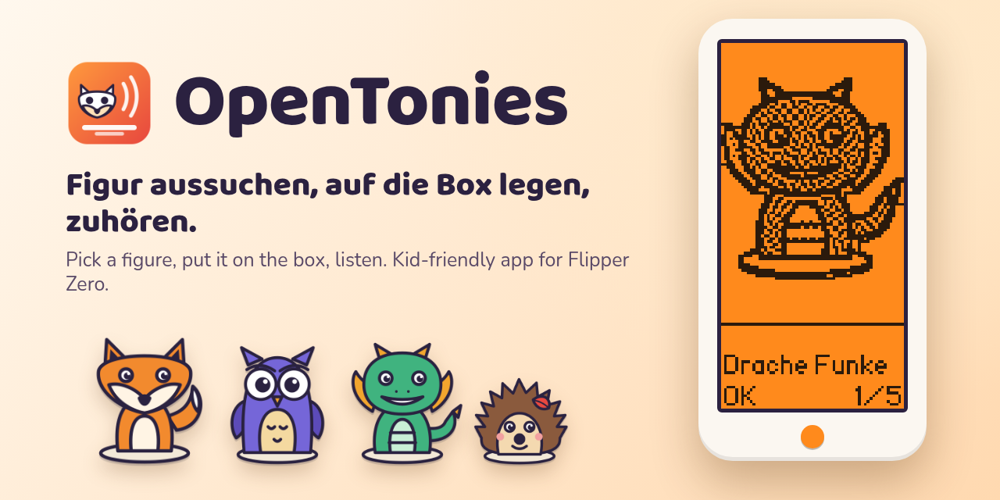
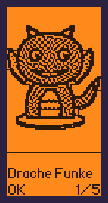
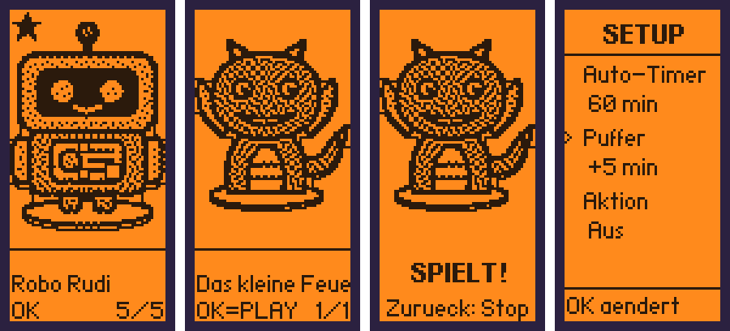
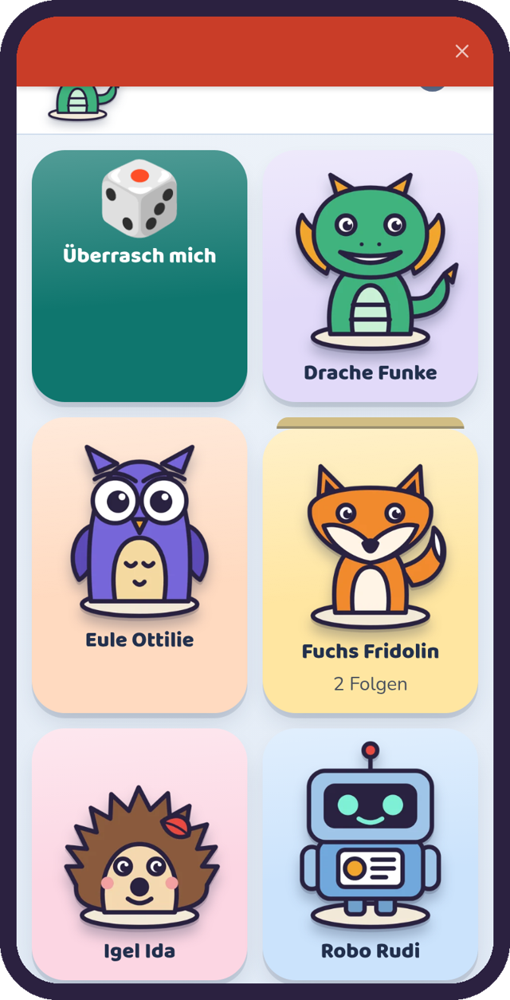
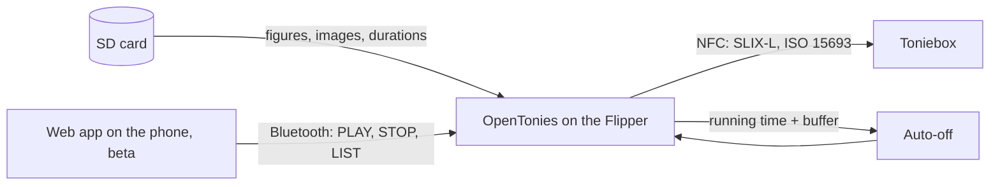

<p align="center">
  
</p>

<p align="center">
  <a href="README.md">Deutsch</a> · <strong>English</strong>
</p>

<p align="center">
  <a href="https://github.com/ElektroGandhi/OpenToniesFlipperZero/actions/workflows/ci.yml"></a>
  <a href="https://github.com/ElektroGandhi/OpenToniesFlipperZero/releases"></a>
  <a href="LICENSE"></a>
  
</p>

<p align="center">💡 Ideas by <strong>BLOTTO</strong> · 🤖 vibed by <strong>OPUS</strong></p>

# OpenTonies

**A kid-friendly Flipper Zero app:** the child picks a figure by its picture, the Flipper
emulates it, and the Toniebox plays. A phone library that starts and stops playback over
Bluetooth is available as a **beta**.

<p align="center">
  
  &nbsp;&nbsp;
  
</p>

<p align="center">
  🎬 <a href="docs/media/demo.mp4">Watch the video</a> ·
  🌐 <a href="https://elektrogandhi.github.io/OpenToniesFlipperZero/">Try the web demo (beta)</a> ·
  ⬇️ <a href="https://github.com/ElektroGandhi/OpenToniesFlipperZero/releases">Download the app</a>
</p>

> The Flipper screens come from the real device; the graphics and the web view are our own work.
> Everything shows the included **demo library** with five made-up figures. The repository contains
> no NFC dumps and no product images.

## What it does

| | |
|---|---|
| 🖼️ **Choose by picture** | Portrait layout with a large figure image. Children who can't read yet can still use it. |
| 🗂️ **Series → episode** | Two levels to navigate. Subfolders such as `Book Tonies/Conni/` are included automatically. |
| ⏱️ **Auto-off with buffer** | Ends emulation after the running time. **New:** an adjustable buffer of 0 to 30 minutes, 5 by default. |
| ⭐ **Favorites** | A long press on OK remembers a series. It moves to the front on the next start. |
| 💡 **LED feedback** | Blinks during emulation, with selectable color and brightness. |
| 📲 **Phone library (beta)** | Figures by theme and series, descriptions with read-aloud, start and stop over Bluetooth. |
| 🧸 **Demo library** | Five made-up figures to try out, with no third-party material at all. |
| 🔌 **Data-driven** | No built-in figure list. The app reads everything from the SD card at runtime. |

## Quick start

**Ready-made app:** download `toniekids-momentum.fap` or `toniekids-official.fap` from the
[releases page](https://github.com/ElektroGandhi/OpenToniesFlipperZero/releases) and copy it to
`SD:/apps/NFC/`. You will then find it under **Apps → NFC → OpenTonies**.

**Build it yourself:**

```sh
pip install --user ufbt pyserial pillow

# Choose an SDK, Momentum in this example
ufbt update --channel=release --index-url=https://up.momentum-fw.dev/firmware/directory.json

cd src
ufbt launch                                 # build, install, start
```

**Try it without your own figures:**

```sh
python3 tools/demo_bibliothek.py --an       # hide your own collection, install the demo
python3 tools/demo_bibliothek.py --aus      # remove the demo, restore your collection
```

## Controls

Hold the Flipper upright while using it.

| Button | Effect |
|---|---|
| **Arrow keys** | Previous or next series or episode. Hold to scroll quickly. |
| **OK** | Open a series or start an episode. Then put the Flipper on the box. |
| **Long OK** | Add or remove a series as a favorite. |
| **Back** | Stop emulation, go up one level, leave the app. |
| **Long Back** | Open the hidden setup for adults. |

## Settings

A **long press on Back** opens the setup. **Up/Down** selects an entry, **OK** changes its value,
**Back** saves. The app itself uses German labels, shown here as they appear on the device.

| Entry | Values | Effect |
|---|---|---|
| **Schrift** | GROSS, klein | How names are written: upper case or normal. |
| **Bilder** | AN, AUS | `AUS` is reading mode: text only, so the child reads. |
| **LED** | AN, AUS | Blinking during emulation. |
| **LED-Farbe** | 7 colors | Color of the blinking. |
| **Helligkeit** | niedrig, mittel, hoch | LED brightness: low, medium, high. |
| **Auto-Timer** | Aus, 30, 45, 60, 90 min | Ends emulation. If the running time is known, it replaces this value. `Aus` (off) never ends it. Default: Aus. |
| **Puffer** | +0, +5, +10, +15, +20, +30 min | Buffer added to the timer duration. Default: +5 min. |
| **Aktion** | Aus, Replay | Stop at the end, or restart after a 5 s pause (experimental). |
| **Laufschrift** | Aus to schnell | Scrolls long names, from off to fast. |
| **Log** | AN, AUS | Writes a log to `apps_data/toniekids/log.txt`. |
| **Bluetooth** | AN, AUS | Allows the phone library (beta). Default: AUS (off). |

**Worked example:** an episode runs for 42 minutes according to the table and the buffer is set to
+5. Emulation ends after 47 minutes. If no running time is known and the auto-timer is set to
60 minutes, it ends after 65 minutes.

## Your own figures

The app reads these folders on the SD card:

```text
SD:/nfc/Toniebox Figuren/<Series>/<Episode>.nfc
SD:/nfc/Toniebox Figuren/<Group>/<Series>/<Episode>.nfc
SD:/apps_data/toniekids/icons_p/<Series>/<Episode>.fxbm   (optional, 64×96)
SD:/apps_data/toniekids/icons_p/<Series>/_series.fxbm     (optional, series image)
SD:/apps_data/toniekids/durations.txt                     (optional)
```

Read **your own** figures with the Flipper's NFC app and put the files there. They appear on the
next start. Without an image, the app shows only the name.
Images and running times are generated with the [tools](#tools).

## Phone library (beta)

> 🧪 **Beta:** we are still working on this feature. The Bluetooth connection between phone and
> Flipper has not yet been tested on real hardware.

The web app in [`web/`](web/) shows the collection on your phone while the Flipper stays on the
box. It runs in Chrome and Edge on Android and on the desktop. Safari on the iPhone has no Web
Bluetooth; for that case there is the optional [ESP8266 bridge](esp_bridge/README.md).

<p align="center">
  
</p>

Details and protocol (German): [`web/README.md`](web/README.md).

## Tools

| Tool | Purpose |
|---|---|
| [`tools/demo_bibliothek.py`](tools/demo_bibliothek.py) | Build, install and remove the demo library. |
| [`tools/update_tonies.py`](tools/update_tonies.py) | Store the community collection's data locally. |
| [`tools/sd_abgleich.py`](tools/sd_abgleich.py) | Sync the SD card with the local state. Never deletes. |
| [`tools/gen_library.py`](tools/gen_library.py) | Generate `library.json` and images for the web app. |
| [`tools/gen_durations.py`](tools/gen_durations.py) | Add running times. |
| [`tools/gen4.py`](tools/gen4.py) | Generate images for the Flipper (outline + Atkinson dithering). |
| [`tools/flipper_rpc.py`](tools/flipper_rpc.py) | Control and photograph the device over USB. |
| [`tools/pruefe_web.py`](tools/pruefe_web.py) | Measure the web app's tap targets and contrast. |

## How it works



## Status

Whatever is marked as checked really ran. Everything else is named explicitly.

| Area | Status |
|---|---|
| Menu, images, favorites, setup | ✅ checked on the device (Momentum dev, API 87.1) |
| Buffer and auto-off | ✅ checked on the device: 1 min duration + 5 min buffer ends after 6 min |
| Subfolders (third level) | ✅ checked on the device |
| Playback on a real Toniebox | ✅ confirmed in July 2026; ⚠️ this version not yet re-tested on the box |
| Build for Momentum (dev, release) | ✅ builds; release not checked on the device |
| Build for the official firmware (API 88.2) | ✅ builds; ⚠️ not checked on the device |
| Phone library over Bluetooth | 🧪 **Beta:** builds, work in progress, not yet tested on real hardware |
| ESP8266 bridge for the iPhone | 🧪 **Beta:** optional and not yet tested |

## Contributing

Bug reports, ideas and pull requests are welcome. Please read
[`CONTRIBUTING.md`](CONTRIBUTING.md) first. A test report on Bluetooth or on another firmware would
help most right now. Please report security issues as described in [`SECURITY.md`](SECURITY.md).

**Planned:**

- Measure Bluetooth and NFC at the same time on real hardware
- Better coverage in the running-time table
- A simple way to use it on the iPhone

## Legal

The project's own code is under the [MIT license](LICENSE). The repository contains **no** NFC
dumps, product images or content texts, only a table of titles and running times. Use OpenTonies **only with figures you own**, and within
the laws that apply to you. "Tonie" and "Toniebox" are trademarks of Boxine GmbH. This project is
not affiliated with Boxine. More in [`NOTICE.md`](NOTICE.md).

## Thanks

- [nortakales/flipper-zero-tonies](https://github.com/nortakales/flipper-zero-tonies): groundwork on SLIX-L for the Flipper
- [toniebox-reverse-engineering](https://github.com/toniebox-reverse-engineering): open database and research
- [Momentum Firmware](https://github.com/Next-Flip/Momentum-Firmware) and [Flipper Zero](https://github.com/flipperdevices/flipperzero-firmware): firmware and NFC stack
- [Baloo 2](https://github.com/EkType/Baloo2) and [Nunito](https://github.com/googlefonts/nunito): web app fonts (OFL)

## Who made this

**BLOTTO** doesn't program, but has the ideas and operates the machine: the concept, the portrait
layout, the child-friendly controls and every decision come from BLOTTO. The code, graphics and
music were created by **Claude Opus**. This is an openly declared vibe-coding project: a good idea
shouldn't fail just because someone can't program.
