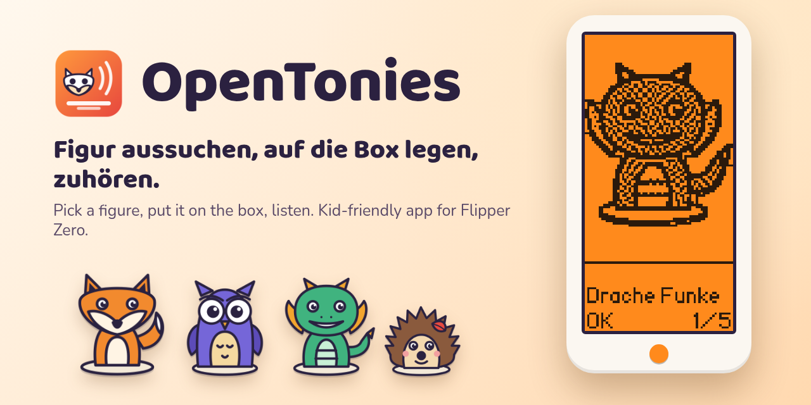
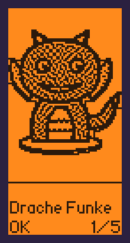
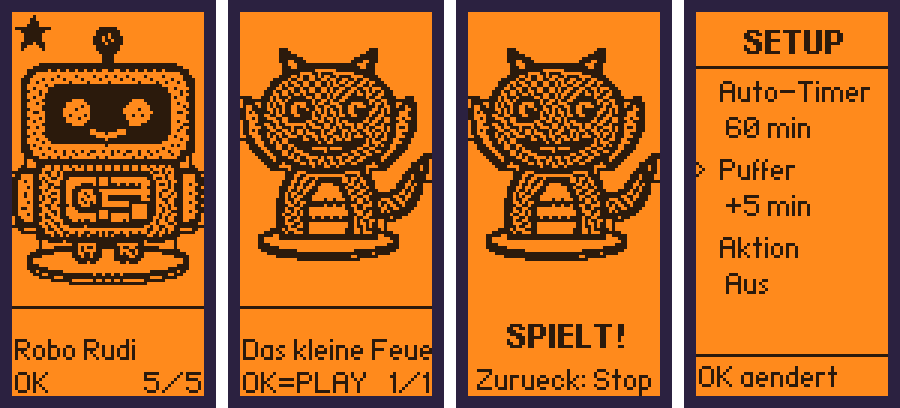
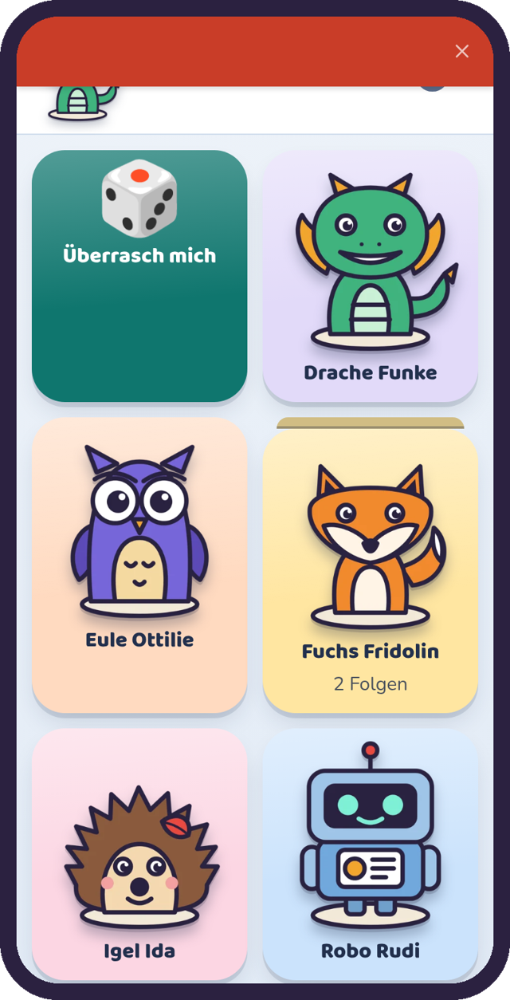
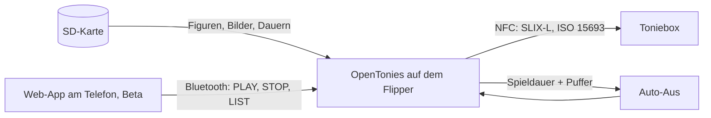

<p align="center">
  
</p>

<p align="center">
  <strong>Deutsch</strong> · <a href="README.en.md">English</a>
</p>

<p align="center">
  <a href="https://github.com/ElektroGandhi/OpenToniesFlipperZero/actions/workflows/ci.yml"></a>
  <a href="https://github.com/ElektroGandhi/OpenToniesFlipperZero/releases"></a>
  <a href="LICENSE"></a>
  
</p>

<p align="center">💡 Ideas by <strong>BLOTTO</strong> · 🤖 vibed by <strong>OPUS</strong></p>

# OpenTonies

**Eine kinderfreundliche Flipper-Zero-App:** Das Kind sucht eine Figur am Bild aus, der
Flipper emuliert sie, und die Toniebox spielt. Als **Beta** gibt es dazu eine Bibliothek fürs
Telefon, die per Bluetooth startet und stoppt.

<p align="center">
  
  &nbsp;&nbsp;
  
</p>

<p align="center">
  🎬 <a href="docs/media/demo.mp4">Video ansehen</a> ·
  🌐 <a href="https://elektrogandhi.github.io/OpenToniesFlipperZero/">Web-Demo ausprobieren (Beta)</a> ·
  ⬇️ <a href="https://github.com/ElektroGandhi/OpenToniesFlipperZero/releases">App herunterladen</a>
</p>

> Die Flipper-Bildschirme stammen vom echten Gerät, Grafiken und Web-Ansicht sind eigene Arbeit.
> Alles zeigt die mitgelieferte **Demo-Bibliothek** mit fünf frei erfundenen Figuren. Das
> Repository enthält keine NFC-Dumps und keine Produktbilder.

## Was es kann

| | |
|---|---|
| 🖼️ **Auswahl über Bilder** | Hochformat mit großem Figurenbild. Wer noch nicht lesen kann, kommt trotzdem zurecht. |
| 🗂️ **Serie → Folge** | Zwei Ebenen in der Bedienung. Unterordner wie `Book Tonies/Conni/` werden automatisch eingereiht. |
| ⏱️ **Auto-Aus mit Puffer** | Beendet die Emulation nach der Spieldauer. **Neu:** ein einstellbarer Puffer von 0 bis 30 Minuten, voreingestellt sind 5. |
| ⭐ **Favoriten** | Langes OK merkt sich eine Serie. Sie steht beim nächsten Start vorne. |
| 💡 **LED-Rückmeldung** | Blinkt während der Emulation, Farbe und Helligkeit sind wählbar. |
| 📲 **Bibliothek fürs Telefon (Beta)** | Figuren nach Thema und Serie, Beschreibung und Vorlesen, Start und Stopp per Bluetooth. |
| 🧸 **Demo-Bibliothek** | Fünf erfundene Figuren zum Ausprobieren, ganz ohne fremdes Material. |
| 🔌 **Datengetrieben** | Keine feste Figurenliste. Die App liest alles zur Laufzeit von der SD-Karte. |

## Schnellstart

**Fertige App:** `toniekids-momentum.fap` oder `toniekids-official.fap` von der
[Release-Seite](https://github.com/ElektroGandhi/OpenToniesFlipperZero/releases) laden und nach
`SD:/apps/NFC/` kopieren. Danach liegt sie unter **Apps → NFC → OpenTonies**.

**Selbst bauen:**

```sh
pip install --user ufbt pyserial pillow

# SDK wählen, hier Momentum
ufbt update --channel=release --index-url=https://up.momentum-fw.dev/firmware/directory.json

cd src
ufbt launch                                 # bauen, aufspielen, starten
```

**Ohne eigene Figuren ausprobieren:**

```sh
python3 tools/demo_bibliothek.py --an       # eigene Sammlung verstecken, Demo aufspielen
python3 tools/demo_bibliothek.py --aus      # Demo entfernen, Sammlung zurückholen
```

## Bedienung

Den Flipper dabei senkrecht halten.

| Taste | Wirkung |
|---|---|
| **Pfeiltasten** | Vorige oder nächste Serie bzw. Folge. Halten blättert schnell. |
| **OK** | Serie öffnen oder Folge starten. Danach den Flipper auf die Box legen. |
| **OK lang** | Serie als Favorit markieren oder die Markierung entfernen. |
| **Zurück** | Emulation stoppen, eine Ebene zurück, App verlassen. |
| **Zurück lang** | Verstecktes Setup für Erwachsene öffnen. |

## Einstellungen

Das Setup öffnet sich mit **langem Zurück**. **Hoch/Runter** wählt den Eintrag, **OK** ändert den
Wert, **Zurück** speichert.

| Eintrag | Werte | Wirkung |
|---|---|---|
| **Schrift** | GROSS, klein | Schreibweise der Namen. |
| **Bilder** | AN, AUS | `AUS` ist der Lesemodus: nur Text, damit das Kind liest. |
| **LED** | AN, AUS | Blinken während der Emulation. |
| **LED-Farbe** | 7 Farben | Farbe des Blinkens. |
| **Helligkeit** | niedrig, mittel, hoch | Helligkeit der LED. |
| **Auto-Timer** | Aus, 30, 45, 60, 90 min | Beendet die Emulation. Ist die Spieldauer bekannt, gilt sie statt dieses Werts. `Aus` schaltet nie ab. Standard: Aus. |
| **Puffer** | +0, +5, +10, +15, +20, +30 min | Spielraum, der auf die Timer-Zeit aufgeschlagen wird. Standard: +5 min. |
| **Aktion** | Aus, Replay | Am Ende stoppen oder nach 5 s Pause neu starten (experimentell). |
| **Laufschrift** | Aus bis schnell | Lässt lange Namen durchlaufen. |
| **Log** | AN, AUS | Schreibt ein Protokoll nach `apps_data/toniekids/log.txt`. |
| **Bluetooth** | AN, AUS | Erlaubt die Bibliothek fürs Telefon (Beta). Standard: AUS. |

**Rechenbeispiel:** Eine Folge dauert laut Tabelle 42 Minuten, der Puffer steht auf +5. Die
Emulation endet nach 47 Minuten. Ist keine Spieldauer bekannt und steht der Auto-Timer auf
60 Minuten, endet sie nach 65 Minuten.

## Eigene Figuren

Die App liest diese Ordner auf der SD-Karte:

```text
SD:/nfc/Toniebox Figuren/<Serie>/<Folge>.nfc
SD:/nfc/Toniebox Figuren/<Gruppe>/<Serie>/<Folge>.nfc
SD:/apps_data/toniekids/icons_p/<Serie>/<Folge>.fxbm      (optional, 64×96)
SD:/apps_data/toniekids/icons_p/<Serie>/_series.fxbm      (optional, Bild der Serie)
SD:/apps_data/toniekids/durations.txt                     (optional)
```

Lies deine **eigenen** Figuren mit der NFC-App des Flippers aus und lege die Dateien dort ab. Sie
erscheinen beim nächsten Start. Ohne Bild zeigt die App nur den Namen.
Bilder und Spieldauern erzeugst du mit den [Werkzeugen](#werkzeuge).

## Bibliothek fürs Telefon (Beta)

> 🧪 **Beta:** An dieser Funktion arbeiten wir noch. Die Bluetooth-Verbindung zwischen Telefon und
> Flipper ist auf echter Hardware noch nicht geprüft.

Die Web-App in [`web/`](web/) zeigt die Sammlung am Telefon. Der Flipper bleibt dabei auf der Box
liegen. Die Web-App läuft in Chrome und Edge auf Android und am Desktop. Safari auf dem iPhone kann kein
Web Bluetooth; für diesen Fall gibt es die optionale [ESP8266-Brücke](esp_bridge/README.md).

<p align="center">
  
</p>

Details und Protokoll: [`web/README.md`](web/README.md).

## Werkzeuge

| Werkzeug | Aufgabe |
|---|---|
| [`tools/demo_bibliothek.py`](tools/demo_bibliothek.py) | Demo-Bibliothek bauen, auf- und abspielen. |
| [`tools/update_tonies.py`](tools/update_tonies.py) | Datenstand der Gemeinschaftssammlung lokal ablegen. |
| [`tools/sd_abgleich.py`](tools/sd_abgleich.py) | SD-Karte mit dem lokalen Stand abgleichen. Löscht nie. |
| [`tools/gen_library.py`](tools/gen_library.py) | `library.json` und Bilder für die Web-App erzeugen. |
| [`tools/gen_durations.py`](tools/gen_durations.py) | Spieldauern nachtragen. |
| [`tools/gen4.py`](tools/gen4.py) | Bilder für den Flipper erzeugen (Kontur + Atkinson-Dithering). |
| [`tools/flipper_rpc.py`](tools/flipper_rpc.py) | Gerät per USB fernsteuern und fotografieren. |
| [`tools/pruefe_web.py`](tools/pruefe_web.py) | Web-App auf Tippziele und Kontrast messen. |

## So funktioniert es



## Stand

Was hier als geprüft steht, lief wirklich. Alles andere ist ausdrücklich benannt.

| Bereich | Stand |
|---|---|
| Menü, Bilder, Favoriten, Setup | ✅ am Gerät geprüft (Momentum dev, API 87.1) |
| Puffer und Auto-Aus | ✅ am Gerät geprüft: 1 min Dauer + 5 min Puffer endet nach 6 min |
| Unterordner (dritte Ebene) | ✅ am Gerät geprüft |
| Wiedergabe an einer echten Toniebox | ✅ im Juli 2026 bestätigt; ⚠️ diese Fassung noch nicht erneut an der Box |
| Build für Momentum (dev, release) | ✅ gebaut; release nicht am Gerät geprüft |
| Build für die offizielle Firmware (API 88.2) | ✅ gebaut; ⚠️ nicht am Gerät geprüft |
| Bibliothek fürs Telefon über Bluetooth | 🧪 **Beta:** gebaut, in Arbeit, auf echter Hardware noch ungeprüft |
| ESP8266-Brücke fürs iPhone | 🧪 **Beta:** optional und noch ungeprüft |

## Mitmachen

Fehlerberichte, Ideen und Pull-Requests sind willkommen. Bitte vorher
[`CONTRIBUTING.md`](CONTRIBUTING.md) lesen. Am meisten hilft gerade ein Testbericht zu Bluetooth
oder zu einer anderen Firmware. Sicherheitsprobleme bitte nach [`SECURITY.md`](SECURITY.md) melden.

**Geplant:**

- Bluetooth und NFC gleichzeitig am echten Gerät nachmessen
- höhere Abdeckung der Spieldauer-Tabelle
- ein einfacher Weg fürs iPhone

## Rechtliches

Eigener Code steht unter der [MIT-Lizenz](LICENSE). Das Repository enthält **keine** NFC-Dumps,
keine Produktbilder und keine Inhaltstexte, nur eine Tabelle mit Titeln und Spieldauern. Nutze OpenTonies **nur mit Figuren, die dir gehören**,
und im Rahmen der für dich geltenden Gesetze. „Tonie“ und „Toniebox“ sind Marken der Boxine GmbH.
Dieses Projekt steht in keiner Verbindung zu Boxine. Mehr dazu in [`NOTICE.md`](NOTICE.md).

## Danke

- [nortakales/flipper-zero-tonies](https://github.com/nortakales/flipper-zero-tonies): Vorarbeit zu SLIX-L auf dem Flipper
- [toniebox-reverse-engineering](https://github.com/toniebox-reverse-engineering): offene Datenbank und Forschung
- [Momentum Firmware](https://github.com/Next-Flip/Momentum-Firmware) und [Flipper Zero](https://github.com/flipperdevices/flipperzero-firmware): Firmware und NFC-Stack
- [Baloo 2](https://github.com/EkType/Baloo2) und [Nunito](https://github.com/googlefonts/nunito): Schriften der Web-App (OFL)

## Wer das gemacht hat

**BLOTTO** programmiert nicht selbst, hat aber die Ideen und bedient die Maschine: Konzept,
Hochformat, kindgerechte Bedienung und jede Entscheidung stammen von BLOTTO. Den Code, die
Grafiken und die Musik hat **Claude Opus** erstellt. Das ist ein offen benanntes
Vibecoding-Projekt: Eine gute Idee soll nicht daran scheitern, dass man nicht programmieren kann.
